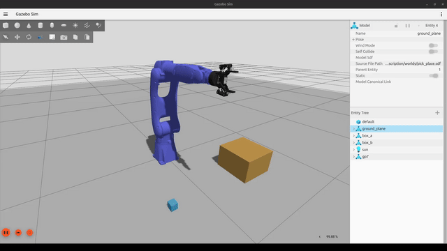
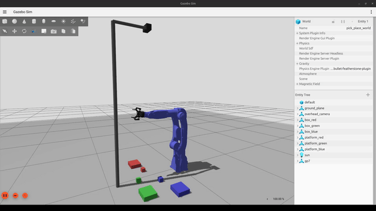
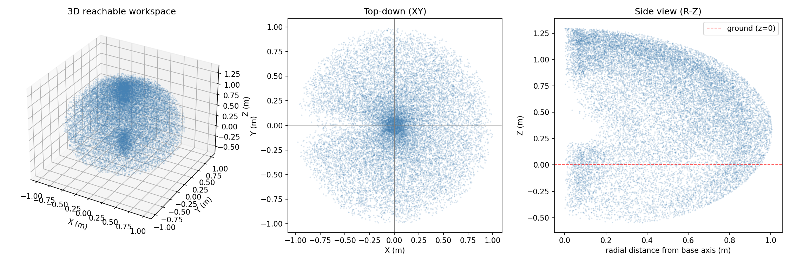

# GP7 Pick-and-Place (Gazebo simulation)

## Demo

Pick-and-place of Box B onto Box A with a Yaskawa Motoman GP7, fully in simulation.



## Demo 2 — vision-driven pick-and-place (VLA extension)



*(Beyond the assignment: a small vision-language pipeline — Moondream2 locates
each colored box and platform from a live camera image, converts pixel
coordinates to 3D world positions, and feeds them into the same verified
IK/trajectory pipeline above. Sequence shown: red box → red platform, blue
box → blue platform, green box → green platform, matched purely from a
natural-language description of each object, not hardcoded coordinates. See
`src/gp7_pick_place/gp7_pick_place/vla/` for the full pipeline.)*

## Structure

```
6DoF-Robot-Manipulator-Simulation/
├── report/                       D-H table, FK/IK derivations, writeup
│   └── images/
│       ├── dh-frames.jpg         hand-drawn coordinate frame assignment
│       ├── datasheet_image.jpg   Yaskawa dimensional drawing, used to sanity-check link lengths
│       └── workspace_plot.png    reachable-workspace point cloud (see Workspace analysis)
├── media/
│   ├── pick_and_place_demo.mp4   screen-recorded simulation video
│   ├── pick_and_place_demo.gif   same recording as a GIF (embedded above)
│   └── vla_sequence_demo.gif     screen-recorded VLA sequence (embedded above)
└── src/
    ├── gp7_description/          URDF/xacro, meshes, worlds, ros2_control + Gazebo bring-up
    └── gp7_pick_place/           FK/IK, trajectory planning, velocity control, mission node
        └── vla/                  Moondream2-based perception -> world-position pipeline
```

## Setup

```bash
rosdep install --from-paths src --ignore-src -r -y
colcon build --symlink-install
source install/setup.bash
```

Verify the model in RViz (no physics, just geometry/TF):
```bash
ros2 launch gp7_description display.launch.py
```

Bring up the full Gazebo simulation (Box A, Box B, ros2_control):
```bash
ros2 launch gp7_description gazebo.launch.py
```

Run the full pick-and-place sequence (Gazebo must already be running):
```bash
cd src/gp7_pick_place/gp7_pick_place
python3 run_pick_place.py
```

## Acknowledgment

`gp7_description`'s link geometry, joint origins/axes/limits, and meshes are
ported from the ROS-Industrial project's `motoman_gp7_support` package
(github.com/ros-industrial/motoman, `kinetic-devel` branch, BSD licensed).
Per-link mass/inertia (not present in the source, which only needed
visual/collision geometry for ROS 1 MoveIt use) was derived from real mesh
volume, scaled so total mass matches Yaskawa's published 34 kg product mass.
The gripper (`robotiq_description`, `2f_85`) is vendored from
github.com/robotiq/ros (BSD-3-Clause), stripped to the description package
only. The ROS 1 → ROS 2 packaging, the Gazebo/ros2_control integration, and
the trajectory/mission code are original to this project.

## Simulation setup

**Box positions differ from the task sheet's (1, 1, 0).** Reachability check
against the verified D-H parameters: max wrist-centre radius is
`a1 + a2 + l_eff` = 40 + 445 + 441.8 = **926.8 mm**. Box A at (1, 1) is
1414 mm from the base — outside the arm's reach regardless of gripper or IK
branch. Relocated to **Box A (0.5, 0.5, 0)**, **Box B (0.55, −0.25, 0.025)**
— both within the reachable envelope, with clearance between them for the
descent path.

**Gripper: Robotiq 2F-85**, not the task sheet's minimum "simplified gripper"
requirement, chosen for a more realistic grasp. One real finding worth
noting: Gazebo's default DART physics engine does not implement mimic-joint
constraints (the 2F-85's 5 driven-follower joints), so the fingers moved
asymmetrically under DART. Switched to the `bullet-featherstone` physics
engine, which does support them — confirmed via the `Physics.cc` mimic
warning disappearing and symmetric finger motion in testing.

## Kinematics

### Coordinate frame assignment


*(Frames assigned per standard D-H convention; frame 0 at the base center on
the ground, z-axes along each joint's rotation axis. z1/z2 confirmed parallel
— joints L and U rotate about the same line, opposite sign.)*


*(Manufacturer dimensional drawing, used only as a rough sanity check — the
arm is shown in a bent pose here, so its dimension lines mix multiple links'
projections and don't map 1:1 to individual D-H parameters. Actual a/d values
come from the CAD-derived joint offsets in gp7_macro.xacro, see below.)*

### D-H parameter table

| Link i | aᵢ (m) | αᵢ (°) | dᵢ (m) | θᵢ |
|---|---|---|---|---|
| 1 | 0.040 | 90  | 0.330 | θ1* |
| 2 | 0.445 | 0   | 0     | θ2* |
| 3 | 0.040 | 90  | 0     | θ3* |
| 4 | 0     | 270 | 0.440 | θ4* |
| 5 | 0     | 90  | 0     | θ5* |
| 6 | 0     | 0   | 0.080 | θ6* |

All `a`/`d` values taken from the real joint offsets in
`gp7_description/urdf/gp7_macro.xacro` (ROS-Industrial CAD data). Cross-checked
against an independent published D-H table for this exact robot (da Silva et
al., *Determination of the Inverse Kinematic of the Industrial Robot
Yaskawa-Motoman-Gp7*, Adv. Rob. & Mech. Engin. 2022) — all six rows agree.

### Joint variable conventions (important — not raw encoder angles)

The frame axes as drawn don't line up 1:1 with the physical joint zero
positions or rotation directions, so three of the six joints need a conversion
between the physical joint angle and the θ actually fed into the D-H matrix:

| Joint | D-H θ used in `dh_transform` | Physical joint angle |
|---|---|---|
| 1 | θ1 | = θ1 |
| 2 | 90° − θ2 | (frame's θ=0 has x1⊥x2; physical zero has the upper arm vertical, a 90° difference; rotation direction also opposite) |
| 3 | θ3 | = θ3 |
| 4 | −θ4 | (chosen z4 direction opposite to the real `joint_4_r` URDF axis) |
| 5 | θ5 | = θ5 |
| 6 | −θ6 | (z5 = +x at zero pose, opposite to the `joint_6_t` URDF axis −x) |

Found by: matching computed FK against the true physical zero-pose position
(0.560, 0, 0.815 m, from the raw xacro offset chain) revealed the θ2 offset;
matching a live non-zero configuration against `tf2_echo` (which the offset
alone didn't fix) isolated the θ4 sign flip. The θ6 sign flip only shows in
orientation (joint 6 rotates about an axis through the flange origin, so
position checks cannot see it); it was found by comparing full transforms
against `robot_state_publisher` on random joint vectors (after the fix: max
residual 5.2e-13 mm and 6.7e-14° over 20 random configurations).

### Forward kinematics — verification

FK implemented as the standard D-H transform per link
(`Rz(θ)·Tz(d)·Tx(a)·Rx(α)`, six matrices multiplied in order), in
`gp7_pick_place/kinematics.py`. Verified against live Gazebo physics via
`ros2 run tf2_ros tf2_echo base_link tool0`, not just self-consistency:

| Joint config (rad) | Predicted (FK) | Live TF (tool0) | Match |
|---|---|---|---|
| [0, 0, 0, 0, 0, 0] | (0.560, 0.000, 0.815) | (0.560, 0.000, 0.815)* | Yes |
| [0.3, 0.2, -0.1, 0.4, 0.15, 0.2] | (0.6095, 0.1934, 0.6615) | (0.609, 0.193, 0.661) | Yes |
| [-0.4, -0.25, 0.3, -0.5, 0.35, -0.2] | (0.304, -0.1428, 1.0851) | (0.304, -0.143, 1.085) | Yes |

*(zero-config target derived analytically from the raw xacro offset chain,
not measured live)*

### Inverse kinematics — method and verification

Closed-form solution via position/orientation decoupling (standard method
for a spherical-wrist 6-DOF arm), in `gp7_pick_place/kinematics.py`:

1. **`wrist_center()`** — back-calculates the spherical-wrist center
   (shared origin of frames 4/5) from a target pose, by stepping back along
   the tool's approach direction (the 3rd column of R06) by `d6`.
2. **`solve_position_joints()`** — θ1 from the wrist center's azimuth; θ2/θ3
   from a law-of-cosines triangle (shoulder–elbow–wrist), correcting for the
   `a1`/`a3` link offsets.
3. **`solve_wrist_orientation()`** — with θ1–3 known, ³R6 = (⁰R3)ᵀ · R06
   isolates the wrist's rotation; θ4/θ5/θ6 extracted from specific elements
   of that matrix.
4. **`inverse_kinematics_tcp()`** — target given at the gripper's grasp point
   (`tcp`, not frame 6): subtracts `L_TCP + D6` along the approach axis before
   the steps above. `inverse_kinematics_tcp_continuous()` additionally picks
   the joint-angle branch nearest a given previous solution, unwrapping ±360°
   ambiguities so consecutive waypoints in a trajectory don't spin the wrist
   unnecessarily (see Trajectory planning below).

**Verified by round-trip** (solve IK for a target pose, feed the result back
through the already-TF-verified FK, confirm the same pose comes out) and
**by live Gazebo cross-check** (command the IK-solved joint angles, confirm
`tcp` actually reaches the intended target via `tf2_echo`):

| Target `tcp` pose | Solved joint angles used | Live TF `tcp` result | Match |
|---|---|---|---|
| (0.5, 0.3, 0.6), identity rotation | [0.5404, 0.3737, -0.2494, -0.0, 2.1939, 2.6012] | (0.500, 0.300, 0.600) | Yes (exact) |

### Trajectory planning and velocity profile

**Waypoint sequence** (approach → grasp → lift → transit → place → retreat),
orientation held fixed (yaw = 0, matching Box B's axis-aligned spawn — not
world-fixed yaw-tracking, which was tried first but approached the box at a
diagonal since the box itself doesn't rotate with the base). Each waypoint
solved with `inverse_kinematics_tcp_continuous()`, chained off the previous
waypoint's solution.

**Velocity profile: LSPB** (Linear Segments with Parabolic Blends —
trapezoidal velocity, parabolic-blend position), per EN3563 Lecture 13
slides 5–11, implemented in `gp7_pick_place/trajectory.py`:
- `segment_timing()` — trapezoidal (`tb = v_max/accel`) or triangular
  (`tb = sqrt(|Δq|/accel)`) blend time, chosen by whether the move is long
  enough to reach `v_max`.
- `lspb_position()` — 3-phase position law (parabolic in / linear / parabolic
  out) per joint.
- `generate_segment_trajectory()` — all 6 joints in a segment share one
  `(tb, tf)`, set by whichever joint needs the most time (the "pacing"
  joint); other joints move slower within the same window using their own
  effective velocity/acceleration.

Verified against real waypoint data: joint position steps between samples
ramp up then down smoothly (0.067° → 0.6° → 0.042° across one segment),
confirming genuine trapezoidal velocity rather than linear interpolation.

### Pick-and-place execution

`gp7_pick_place/run_pick_place.py` solves all 6 waypoints, generates an LSPB
trajectory per segment, and executes via the `FollowJointTrajectory` action
(not just publishing to the topic) — the action's result callback is the
authoritative "motion actually finished" signal from the controller, which
matters because polling `/joint_states` velocities can read near-zero in the
brief window before a new trajectory starts moving, causing the runner to
issue the next command before the arm physically arrives.

Gripper: closes to 0.75 rad (near the measured fully-closed 0.8, leaving
margin) at the grasp waypoint, opens fully at release. `check_tcp_pose()`
confirms actual `tcp` position via TF immediately before each gripper action
for live debugging.

## Testing Sequences and Theory Extensions
### Velocity kinematics (Jacobian)

`jacobian.py` -- geometric Jacobian, `Jw_i = z_{i-1}`, `Jv_i = z_{i-1} x
(o_n - o_{i-1})` per link (standard formulation). Converts D-H joint-velocity
convention to physical joint velocity (same sign-flip issue as FK/IK).
**Verified against finite-difference perturbation of `forward_kinematics()`**
-- predicted vs numerical linear velocity match to 4 decimal places across
all 6 joints.

### Singularity / manipulability analysis

`singularity.py` -- `manipulability()` (`w = sqrt(det(J.J^T))`),
`singular_values()` (SVD), `jacobian_rank()`. **Verified against a known
wrist singularity**: at theta5 = 0 (axes 4 and 6 become collinear), smallest
singular value drops to 0.0000, rank drops 6->5, manipulability -> 0.0
exactly, matching the analytical prediction.

### Multiple IK solutions

Extends `kinematics.py` with all three classic branch types for a
spherical-wrist 6-DOF arm:
- **Elbow-up/down** -- sign ambiguity in the law-of-cosines solve
- **Wrist-flip** -- `theta4' = theta4 - pi, theta5' = -theta5, theta6' =
  theta6 - pi`
- **Shoulder-left/right** -- `theta1' = theta1 + pi` with the arm reaching
  the wrist center from the opposite side of the base axis (`r_planar' =
  -(r + a1)` instead of `r - a1`)

All branches verified via FK round-trip (position error ~1e-16, machine
precision) and filtered against real joint limits -- for a tested target,
only 2 of the 4 elbow x wrist combinations are physically reachable; the
shoulder-flip branch violates joint 1's limit. Demoed live in Gazebo
(`demo_branches.py`): tool tip stays fixed while the arm visibly
reconfigures between reachable branches.

### Workspace / reachability analysis

`workspace.py` -- random joint-space sampling (20,000 configs within real
limits) through `forward_kinematics()`, producing a 3D reachable-point
cloud (`report/images/workspace_plot.png`). Sampled max radius (1.30 m)
checked against an analytical upper bound via the triangle inequality
(1.45 m). **Found and documented a real limitation**: ~17% of samples place
the TCP below ground -- kinematically reachable, physically impossible
without collision, since pure joint-limit sampling doesn't account for
self/environment collision.



*(Side view, right panel: the cluster of points below the dashed ground
line is the ~17% of kinematically-reachable-but-physically-impossible
samples noted above.)*

### Vision-driven pick-and-place (VLA extension)

`gp7_pick_place/vla/` -- a small vision-language perception layer bolted
onto the existing, already-verified motion pipeline, kept in a fully
separate Gazebo scene (`vla_scene.sdf`, `vla_gazebo.launch.py`) so the
graded assignment scene is never touched.

- **Overhead camera** (`vla_scene.sdf`) bridged to ROS via `ros_gz_bridge`,
  mounted on an offset pole + horizontal boom so the mount itself doesn't
  obstruct the camera's own view.
- **Perception**: Moondream2 (2B params, CPU inference, isolated Python venv
  to avoid a `transformers`/`rclpy` dependency clash), queried with a plain
  description of the target object, returns a normalized pixel point.
- **Pixel -> world position** (`pixel_to_world.py`): pinhole projection,
  coefficients fitted against 4 known pixel<->world correspondences rather
  than assumed from camera-frame convention -- confirmed within 2cm of
  ground truth on every point checked.
- **Execution**: the located 3D positions feed straight into the same
  `inverse_kinematics_tcp()` / `trajectory.py` / action-based execution
  used throughout this project -- no new motion code.

**Real finding**: bare color queries ("the blue box") are ambiguous when a
same-colored flat platform is also in frame -- Moondream matched "blue box"
to the visually box-like platform instead of the actual cube. Fixed with
shape-disambiguating phrasing ("the small blue cube" vs "the wide flat blue
platform").

Scripts: `capture_frame.py` (save a camera frame), `gather_targets.py`
(batch-query Moondream for a whole pick/place sequence, venv side),
`execute_sequence.py` (read the gathered targets, run the full sequence,
ROS side, no venv needed).

## Status

- [x] GP7 model ported to ROS 2, Robotiq 2F-85 gripper attached, verified in RViz and Gazebo physics
- [x] Gazebo scene (Box A, Box B, relocated for reachability), ros2_control, both controllers verified with live commands
- [x] D-H parameter table + coordinate frame diagram
- [x] Forward kinematics — verified against live TF across 3 configurations
- [x] Inverse kinematics — position/orientation decoupling, verified by FK round-trip AND live Gazebo TF cross-check
- [x] Trajectory planning + LSPB velocity profile — verified against real waypoint data
- [x] Pick-and-place execution — action-based, gripper actuation, working end to end in Gazebo
- [x] Jacobian / velocity kinematics -- verified against finite-difference FK
- [x] Singularity analysis -- verified against a known wrist singularity
- [x] Multiple IK solutions -- elbow up/down, wrist-flip, shoulder left/right
- [x] Workspace/reachability analysis -- 20k-sample point cloud, plotted
- [x] Vision-driven pick-and-place (VLA extension) -- Moondream2 perception,
      verified pixel-to-world projection, full 3-object sequence demoed live
- [ ] Report writeup