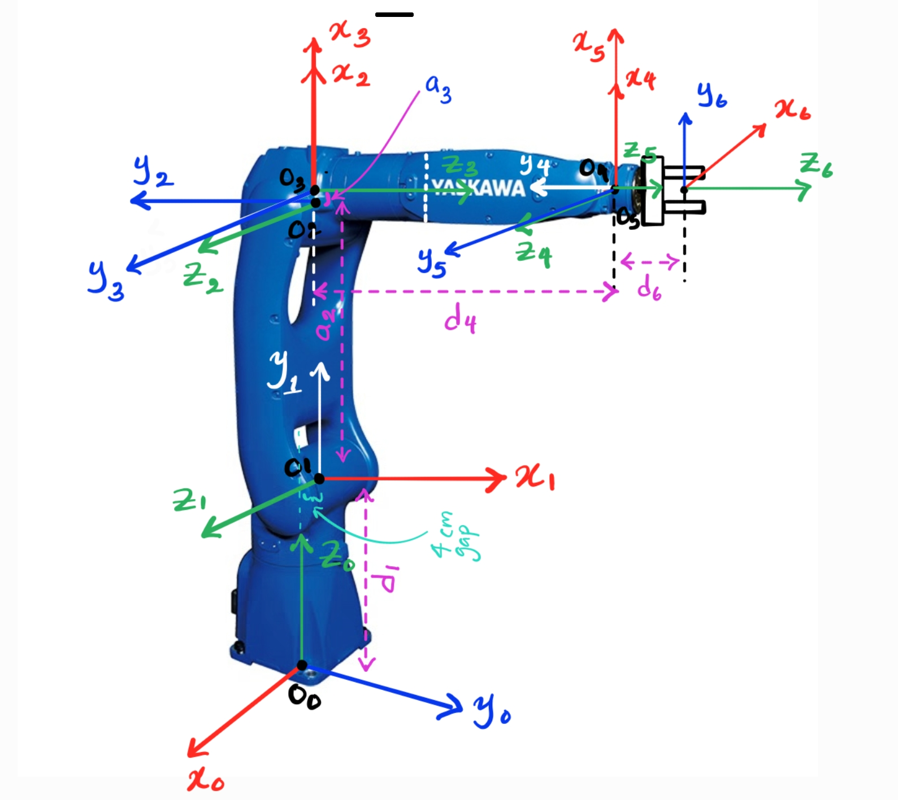
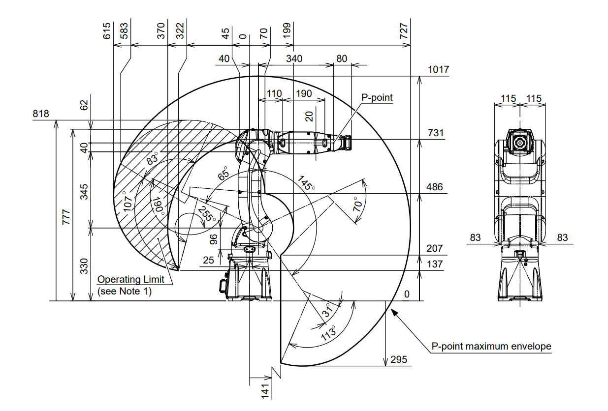

# EN3563 Mini Project — GP7 Pick-and-Place (Gazebo simulation)

Pick-and-place of Box B onto Box A with a Yaskawa Motoman GP7, fully in simulation.

## Structure

```
6DoF-Robot-Manipulator-Simulation/
├── report/                 D-H table, FK/IK derivations, writeup
│   └── images/ 
├── media/                  screen-recorded simulation video
└── src/
    ├── gp7_description/    URDF/xacro, meshes, worlds, ros2_control + Gazebo bring-up
    └── gp7_pick_place/     FK/IK, trajectory planning, velocity control, mission node
```

## Setup

```bash
rosdep install --from-paths src --ignore-src -r -y
colcon build --symlink-install
source install/setup.bash
```

Verify the model in RViz (no physics, just geometry/TF):
```bash
ros2 launch gp7_description display.launch.py
```

Bring up the full Gazebo simulation (Box A, Box B, ros2_control):
```bash
ros2 launch gp7_description gazebo.launch.py
```

## Acknowledgment

`gp7_description`'s link geometry, joint origins/axes/limits, and meshes are
ported from the ROS-Industrial project's `motoman_gp7_support` package
(github.com/ros-industrial/motoman, `kinetic-devel` branch, BSD licensed).
Per-link mass/inertia (not present in the source, which only needed
visual/collision geometry for ROS 1 MoveIt use) was derived from real mesh
volume, scaled so total mass matches Yaskawa's published 34 kg product mass.
The ROS 1 → ROS 2 packaging, the simplified gripper end effector, and the
Gazebo/ros2_control integration are original to this project.

## Kinematics

### Coordinate frame assignment




*(Frames assigned per standard D-H convention; frame 0 at the base center on
the ground, z-axes along each joint's rotation axis. z1/z2 confirmed parallel
— joints L and U rotate about the same line, opposite sign.)*

### D-H parameter table

| Link i | aᵢ (m) | αᵢ (°) | dᵢ (m) | θᵢ |
|---|---|---|---|---|
| 1 | 0.040 | 90  | 0.330 | θ1* |
| 2 | 0.445 | 0   | 0     | θ2* |
| 3 | 0.040 | 90  | 0     | θ3* |
| 4 | 0     | 270 | 0.440 | θ4* |
| 5 | 0     | 90  | 0     | θ5* |
| 6 | 0     | 0   | 0.080 | θ6* |

All `a`/`d` values taken from the real joint offsets in
`gp7_description/urdf/gp7_macro.xacro` (ROS-Industrial CAD data), not scaled
off the manufacturer's dimensional drawing — that drawing shows the arm in a
bent pose, so its dimension lines mix multiple links' projections and don't
map 1:1 to individual D-H parameters. Cross-checked against an independent
published D-H table for this exact robot (da Silva et al., *Determination of
the Inverse Kinematic of the Industrial Robot Yaskawa-Motoman-Gp7*, Adv. Rob.
& Mech. Engin. 2022) — all six rows agree.

### Joint variable conventions (important — not raw encoder angles)

The frame axes as drawn don't line up 1:1 with the physical joint zero
positions or rotation directions, so two of the six joints need a conversion
between the physical joint angle and the θ actually fed into the D-H matrix:

| Joint | D-H θ used in `dh_transform` | Physical joint angle |
|---|---|---|
| 1 | θ1 | = θ1 |
| 2 | 90° − θ2 | (frame's θ=0 has x1⊥x2; physical zero has the upper arm vertical, a 90° difference; rotation direction also opposite) |
| 3 | θ3 | = θ3 |
| 4 | −θ4 | (chosen z4 direction opposite to the real `joint_4_r` URDF axis) |
| 5 | θ5 | = θ5 |
| 6 | θ6 | = θ6 |

Found by: matching computed FK against the true physical zero-pose position
(0.560, 0, 0.815 m, from the raw xacro offset chain) revealed the θ2 offset;
matching a live non-zero configuration against `tf2_echo` (which the offset
alone didn't fix) isolated the θ4 sign flip.

### Forward kinematics — verification

FK implemented as the standard D-H transform per link
(`Rz(θ)·Tz(d)·Tx(a)·Rx(α)`, six matrices multiplied in order), in
`gp7_pick_place/kinematics.py`. Verified against live Gazebo physics via
`ros2 run tf2_ros tf2_echo base_link tool0`, not just self-consistency:

| Joint config (rad) | Predicted (FK) | Live TF (tool0) | Match |
|---|---|---|---|
| [0, 0, 0, 0, 0, 0] | (0.560, 0.000, 0.815) | (0.560, 0.000, 0.815)* | Yes |
| [0.3, 0.2, -0.1, 0.4, 0.15, 0.2] | (0.6095, 0.1934, 0.6615) | (0.609, 0.193, 0.661) | Yes |
| [-0.4, -0.25, 0.3, -0.5, 0.35, -0.2] | (0.304, -0.1428, 1.0851) | (0.304, -0.143, 1.085) | Yes |

*(zero-config target derived analytically from the raw xacro offset chain,
not measured live)*

## Status

- [x] GP7 model ported to ROS 2, gripper attached, verified in RViz
- [x] Gazebo scene (Box A, Box B), ros2_control, both controllers verified with live commands
- [x] D-H parameter table + coordinate frame diagram
- [x] Forward kinematics — verified against live TF across 3 configurations
- [ ] Inverse kinematics
- [ ] Trajectory planning + velocity profile
- [ ] Pick-and-place demo video
